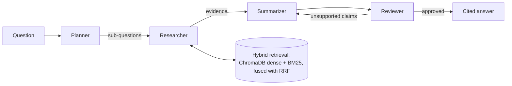

# Multi-Agent Research Assistant (LangGraph + Ollama, fully local)

A stateful multi-agent system that answers questions over your **PDFs and web pages**, with cited sources and an automatic fact-checking loop. Runs 100% locally via Ollama, no API keys.

## Architecture



| Agent | Job |
|---|---|
| Planner | Decomposes the question into 1-3 sub-questions (structured output, Pydantic) |
| Researcher | Hybrid retrieval per sub-question, run concurrently with `asyncio.gather` |
| Summarizer | Writes an answer using ONLY the evidence, with `[S1]` citations |
| Reviewer | Checks each claim against the evidence; sends it back for rewrite if unsupported (max loops configurable) |

## Quick start

```bash
# 1. Ollama
ollama pull llama3.2
ollama pull nomic-embed-text

# 2. Python env
python -m venv .venv && source .venv/bin/activate
pip install -r requirements.txt

# 3. API (terminal 1)
uvicorn app.main:app --reload
# Swagger docs: http://localhost:8000/docs

# 4. UI (terminal 2)
streamlit run ui/streamlit_app.py
```

Upload a PDF or paste a URL in the sidebar, then ask a question.

## Evaluation (do this before quoting any numbers)

1. Ingest your documents.
2. Put 15-20 real questions in `eval/questions.json`.
3. `python -m eval.evaluate` compares a **baseline** (retrieve + one LLM call) against the **multi-agent graph** on latency and groundedness. Results go to `eval/results.md`.

Note: the judge is the same local model, so results are relative, not absolute. A stronger judge model gives better numbers.

## Tests
`pytest -q`

## Project layout
```
app/        agents.py (LangGraph) | retrieval.py (hybrid) | ingestion.py | main.py (FastAPI) | schemas.py
ui/         streamlit_app.py
eval/       evaluate.py, questions.json
tests/      unit tests for chunking, tokenizing, RRF
```

## Known limitations / ideas
- Web data is ingested by URL; a live search tool node (e.g. DuckDuckGo) would be a natural extension.
- Scanned PDFs need OCR (not included).
- Small local models sometimes fail structured output; planner/reviewer fall back safely.
- Next steps: cross-encoder reranking, streaming responses, per-document filtering.
